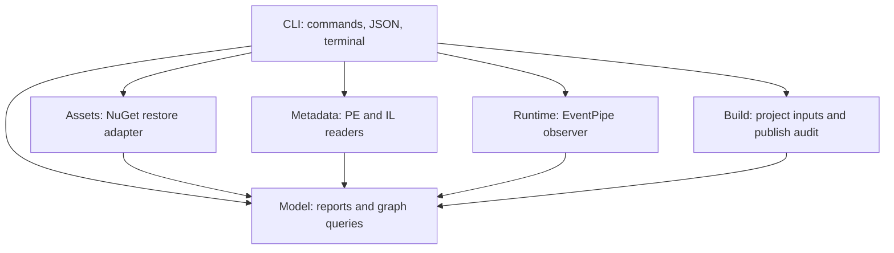

# Architecture and evidence

RefTrace keeps the meaning and provenance of each result explicit. The initial dependency
graph is one source of evidence; it is not stretched into a model for every later feature.

## Module boundaries

`Model` has no runtime package dependencies. `Metadata` uses the BCL and Model; it has no NuGet,
TraceEvent or Spectre dependency. `Assets` owns the NuGet client dependency. `Runtime`
owns the diagnostic client and TraceEvent. `Build` owns subprocess execution. Spectre
belongs only to the CLI. The terminal renderer never decides whether a finding is valid.

Callers reference the owning modules directly. The shared `RefTrace.Core` namespace
contains the report and inspection API; there is no forwarding assembly.
CLI JSON schema 2 and the dependency-first `why` syntax are the current contracts of the 0.x versions.

`ReleaseCatalog` uses NuGet's version comparer. The C# 15 `ReleaseDecision` union keeps
the two outcomes explicit, with exhaustive switch expressions and default-value rejection.
The installed `ref review` command evaluates the target projects, writes an input manifest,
and launches its bundled Python collector. The collector calls the same installed
RefTrace DLL and optional ILSpy probes and stores their evidence;
it does not implement a second NuGet version parser or mutate dependency pins.
`ProjectInputs` resolves assets through MSBuild rather than assuming an output layout.
`ApiSurface` decodes declared signatures from metadata without loading the inspected DLL.
`ProcessCapture` owns cancellation, deadlines, child termination and both output pipes.

## Report serialization and usage analysis

`RefTraceJsonContext` generates the JSON serializers for CLI report envelopes. Some
report properties carry evidence exposed only in JSON; the compact terminal views
do not read every property. The generated serializers are their production consumers.

`RefTrace.sln.DotSettings` includes source-generated files in JetBrains solution-wide
analysis so those reads participate in unused-member checks. Rider uses this shared
solution setting, and `make inspect` explicitly loads it with solution-wide analysis
enabled. Excluding generated files can incorrectly flag these properties as unread.
Inspection severities remain unchanged, and genuinely unread properties still warn.

## Different questions require different evidence

| Question | Source | What it establishes |
| --- | --- | --- |
| Why is a package in this restored target? | `project.assets.json` | Selected versions, asset groups and recorded dependency edges |
| What does a DLL declare/reference? | PE/ECMA-335 metadata | Identity, attributes, static references, declared/forwarded types |
| Where are known reflection APIs referenced? | Method-body IL | Static calls/delegate targets at exact offsets; not execution or reachability |
| What loaded in this process? | EventPipe + completed rundown | Observed assemblies/modules over a recorded interval; not an atomic snapshot |
| Does this configured app publish with Native AOT? | Explicit SDK publish | That command's SDK, RID, output, compiler diagnostics and exit status |

An `IsAotCompatible` declaration is not a publish result. No matching reflection call is
not proof of no reflection. A native executable is not automatically a .NET Native AOT
executable. A dependency-policy pass is not a vulnerability/security verdict.

## Extension rules

* Keep raw evidence and its source in reports; mark unsupported or incomplete evidence.
* Add new artifact formats in their adapter, with fixtures for version/alias/invalid cases.
* Change the reflection catalog version when matching semantics change. Tests must cover
  operand boundaries, framework facades, generic calls and known benign cases.
* Do not hide compiler diagnostics or turn missing metadata/rundown into a successful check.
* Keep package SemVer, JSON schema version and reflection catalog version independent.
* Bump the JSON schema when fields change meaning. Before the first public release,
  change APIs directly and update their consumers rather than adding compatibility layers.
* Native AOT validation belongs to an application with a concrete RID and reachable code.
  Keep metadata-only validation separate from the full CLI/diagnostics dependency closure.
* Audit existing projects in their original SDK/feed/environment context. Isolating a
  generated test fixture and evaluating an existing project are different operations.
* Keep pre-publish MSBuild evaluation distinct from properties after target execution.
  Use a fresh output/log directory per audit. Never reuse a single mutable binlog as
  evidence for several runs, and do not infer final properties from pre-evaluation values.

These boundaries reduce the maintenance surface. SDKs, artifact formats and dependencies
still evolve; pinned versions and behavioral tests are part of the design, not a promise
that future maintenance is unnecessary.
